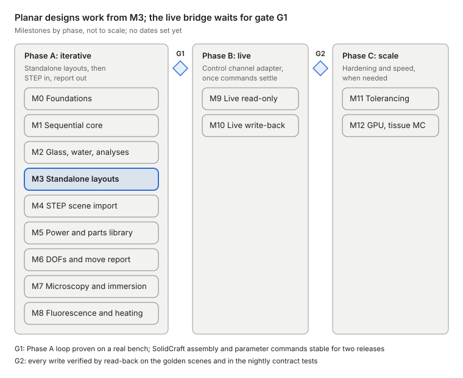

# optobench

A clean-room, pure-Rust optics bench for checking light paths: rays and power traced
through SolidCraft assemblies (via STEP) or through CAD-free planar and optical-table
layouts. Microscopy is a first-class use: immersion and dipping objectives, water,
fluorescence excitation, photon budget and laser heating.

Status: **M0 Foundations**. The workspace, crate layers and repository checks are in place;
optics arrive from M1. See [docs/design.md](docs/design.md) for the design and roadmap.



## Getting started

Requires a stable Rust toolchain (`rust-toolchain.toml` pins the components and the wasm32
target).

```
cargo build
cargo test --workspace
cargo run -p optobench-cli -- version
cargo xtask check
```

Open the folder in VS Code and accept the recommended extensions
(rust-analyzer, Even Better TOML).

## Layout

```
apps/optobench-cli      the `optobench` command
crates/optobench-*      engine and I/O crates, one per layer (see AGENTS.md)
xtask/                  repository checks: layers, naming deny-list, bundled assets
assets/manifest.toml    every bundled data file and its licence
docs/design.md          the design note
docs/milestones/        task lists per milestone
corpus/                 local examples and source data (git-ignored, never committed)
```

## Licence

Licensed under either of [Apache License, Version 2.0](LICENSE-APACHE) or
[MIT license](LICENSE-MIT) at your option. Bundled third-party material is listed in
[ATTRIBUTION.md](ATTRIBUTION.md).

Unless you explicitly state otherwise, any contribution intentionally submitted for
inclusion in this project by you, as defined in the Apache-2.0 license, shall be dual
licensed as above, without any additional terms or conditions.
