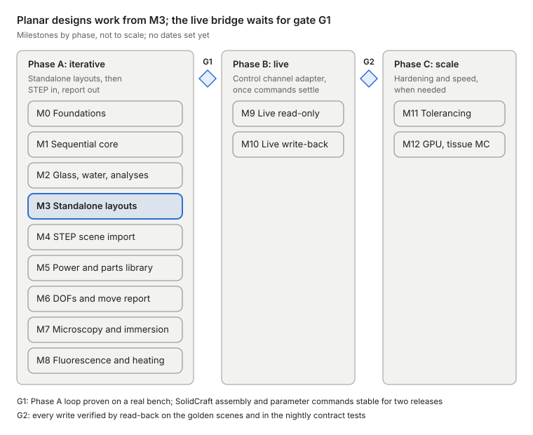

# Optics bench for SolidCraft (design)

Status: draft · 7 November 2026 · Jurjen

Design note for **optobench** (working name): a standalone, clean-room, pure-Rust optics bench that traces light through SolidCraft assemblies. It reads the assembly as STEP plus a sidecar file that marks which bodies are optics, traces rays and power through the real mechanical geometry, and reports clipping, beam footprints, power at each detector and suggested part moves. It also works without any CAD model: simple planar or optical-table layouts can be defined directly. It doesn't fork SolidCraft or depend on its plugin interface, and it is developed independently of the SolidCraft project.

The work runs in two coupling phases. **Phase A (iterative):** files go back and forth, and a person applies the suggested moves in SolidCraft. **Phase B (live):** a separate, later milestone drives SolidCraft through its control channel. Phase B waits until SolidCraft's assembly and parameter commands settle down, and all of it lives in one versioned adapter crate.

Related: SolidCraft docs/plugins.md and issue #1221 (sandboxed plugins, parametric plugin features in phase 2), the control channel and MCP guide (docs.solidcraft.io/guide/mcp), and the command reference.

## Goals and non-goals

The target is checking a light path built from catalog parts (cage systems, lens tubes, mounted lenses, mirrors, galvos) together with custom parts designed in SolidCraft. Full lens design comes second.

**Goals**

- Trace rays through a SolidCraft assembly, with every untagged body treated as an absorber, so clipping by mounts shows up directly.
- Allow designs without a CAD model: planar layouts along an optical axis and simple optical-table layouts on a breadboard grid, with lightweight mechanical proxies (apertures, tubes, plates) for clipping.
- Carry power on every ray: W at each detector, W/m² irradiance maps, and a loss ledger per element.
- Report the beam footprint on each optic and how well it fills each clear aperture.
- Model a part's mechanical degrees of freedom (slide along a rod, tip/tilt on a kinematic mount) and suggest moves only within them.
- Provide a parts library keyed by vendor part number, built from public spec sheets and downloaded by the user.
- Cover microscopy specifics: an ideal objective, scan mirrors, pupil conjugation, Gaussian beams, a vectorial PSF, immersion and dipping objectives focusing into water.
- Propagate the field where diffraction changes the answer (a beam clipped by an iris or a tube, a pinhole, coupling into a fibre, a long path after an aperture): convert traced rays to a sampled field at a plane, propagate it, and hand it back to the ray trace.
- Show results and fields as graphs (profiles, sweeps, spot diagrams, irradiance and field maps) that can be inspected and compared: with theory, with another design, before and after an optimisation, rays against fields.
- Model the imaging target: an aqueous sample with layers, fluorophores, and absorption and scattering, giving fluorescence excitation, a photon budget and laser heating.
- One engine for desktop CLI, desktop UI and wasm32.

**Non-goals (for now)**

- Replacing commercial lens-design suites for multi-element objective design.
- Wave-optics simulation of whole systems (FDTD, BPM through the assembly). Fields are propagated between chosen planes only, in free space and through thin elements; thick optics stay with the ray trace (see Optical model, Field propagation). Photochemistry and photodamage beyond heating and simple bleaching estimates.
- Editing geometry. SolidCraft stays the source of truth for shapes and positions.
- Reading SolidCraft's native .sc design files. That format changes often (format 45 at v0.28), so STEP is the interchange format.

## Ground rules

These follow SolidCraft's own rules, so the code can be upstreamed later without rework.

- **Clean-room.** Behaviour is designed from first principles, textbooks, published papers and public specifications. No commercial optics or CAD product is driven, scripted or used to generate test data or reference values.
- **Licences.** The project is MIT OR Apache-2.0. Adapted code must be MIT or Apache-2.0 and gets a row in ATTRIBUTION.md. GPL code is never read for adaptation. Every dependency is licence-checked in CI (cargo-deny).
- **Bundled assets and data** must be truly open: licence terms that are clear and compatible with MIT OR Apache-2.0 (for example CC0, CC-BY-4.0, MIT, Apache-2.0). That includes third-party databases, such as a glass or refractive-index dataset, when they meet this bar. Each has a row in ATTRIBUTION.md and an entry in an asset manifest that CI checks.
- **Everything else is downloaded by the user.** Databases and libraries without such terms (proprietary glass catalogues, the parts library, coating curves, vendor STEP files) are never bundled. The user downloads them and imports the file (`optobench import-material`; decided 2026-11-07, see Decided). The tool shows the file's licence notice and references before storing anything, and stores the data in the user's data directory.
- **Shared designs are self-contained where possible.** On save, the design file embeds the parameters the work needs, extracted from the sources it used: each element's prescription and the dispersion coefficients actually used, with provenance (source, version, licence, checksum). Anything more (full catalogues, coating curves, STEP geometry) stays a reference. A second user downloads or copies that data themselves, under its own terms. The tool warns before embedding values from a source whose terms forbid redistribution.
- **Vendor data** in the parts library is factual prescription data (radii, thickness, glass, diameter) with a link to the source spec sheet.
- **File formats** come from public specifications: STEP (ISO 10303), plus our own sidecar, layout and library formats. Zemax .zmx has no public specification and is out of scope.
- **Rust only**, f64 throughout, `#![forbid(unsafe_code)]` in every engine crate.
- **Units and frames.** mm, radians and µm for wavelength inside the engine; W for power. Each optical element has a local frame with +z along its optical axis. The scene frame matches SolidCraft's (Z up), and the transform between them is explicit at the boundary.

## Architecture

The crates are layered like SolidCraft's: a crate depends only on crates in its own or a lower layer, never a higher one (checked by `cargo xtask check`). Only `io` and `bridge` know SolidCraft exists, so SolidCraft churn stays inside those two.

| Layer | Crates | Role |
| --- | --- | --- |
| L0 | optobench-math | vectors, frames, transforms, root finding, sampling; no I/O |
| L1 | optobench-surfaces, optobench-materials | analytic surfaces (plane, sphere, conic, even asphere, Zernike) with sag, normal and intersection; dispersion models and glass data |
| L2 | optobench-trace | rays, interactions, sequential and non-sequential tracing, mesh BVH with Newton refinement on exact surfaces |
| L3 | optobench-scene, optobench-library | the optical scene (elements, sources, detectors, DOFs, mechanical proxies) from STEP or from a standalone layout; lookup in user-downloaded parts libraries |
| L4 | optobench-analysis, optobench-field, optobench-optimize | paraxial, spot, OPD, Zernike, PSF/MTF, power ledger, footprints, graphs (as data); sampled fields, their propagation and conversion to and from rays; damped least squares over DOFs and tolerancing |
| L5 | optobench-io, optobench-bridge, optobench-commands | STEP import (our own reader for the AP203/AP214/AP242 subset), sidecar files, reports, graphs drawn as SVG; the control-channel adapter (Phase B); the command registry |
| apps | optobench-cli, optobench-ui | headless CLI; desktop UI with a 3D ray view, later |

Every command is a function taking JSON parameters and returning a JSON result, the same pattern as SolidCraft's run(command, args). The CLI, the UI and a later MCP server, or a SolidCraft plugin once #1221 lands, all call the same command registry, which lives in `optobench-commands` (L5, so commands can read and write files through `optobench-io`). Parameters are a JSON object and parsing is strict, as for files: an unknown key is an error. A failure is `{"error": {"code", "message"}}` with a stable code. On the command line, `optobench <command> [parameters]` takes the object as one argument or `-` for standard input and prints the JSON result.

The engine (L0–L4) has no file system or network access and builds for wasm32. That keeps it usable both as a future SolidCraft plugin and in the browser.

## Coupling with SolidCraft

Both phases share one pose model owned by optobench. The optimizer and reports only ever work on the **DOF vector**. Translating DOF changes into SolidCraft actions is the job of a single adapter, so when SolidCraft's move or joint commands change, only the adapter changes.

**The DOF model.** Each optical element has a *mount frame* and a list of declared degrees of freedom, for example `slide z [-20, +40] mm` on cage rods, or `tip x [-4°, +4°]` and `tilt y [-4°, +4°]` on a kinematic mount. A DOF can also be *coupled* (two mirrors sharing a periscope height) or *locked*. Poses are stored as the nominal pose from STEP plus DOF offsets, never as free 6-DOF transforms. A DOF's range is the travel of its adjuster (a kinematic mount's ±4°, an XY mount's ±1 mm); a mount's adjusters can be written once and given to every part it holds (M14d), alignment prefers adjusters near the middle of their ranges, and short ranges are warned about before the solve.

### Standalone scenes, no CAD (from M3)

A design can start without SolidCraft. A scene file describes the optics directly, and the same engine, DOF model, optimizer and reports apply.

- **Planar layout:** elements placed by distance along a folded optical axis, with fold mirrors given by angle. Shown in 2D, traced in 3D so off-axis fields and tilts still work.
- **Table layout:** elements placed on a breadboard grid (pitch set by the user, e.g. 25 mm or 1 in), with a height above the table and a rotation about Z.
- **Mechanical proxies:** aperture stops, tubes (inner diameter, length) and plates with holes. Enough to find clipping without a CAD model.
- **Reports** give positions in layout coordinates (axis distance, grid hole, height).
- **Upgrade path:** `optobench export-placements` writes the element poses and a matching sidecar, so the layout can be rebuilt in SolidCraft later and matched to its bodies.

### Phase A: iterative (milestones M4–M11)

1. In SolidCraft, the user exports the assembly as STEP, one file per run.
2. `optobench trace design.step --scene design.optobench` reads the geometry and sidecar, matches bodies to sidecar entries by STEP product name, then path, then geometry fingerprint, and traces.
3. The report (HTML + JSON) lists clipping, footprints, the power ledger and detector maps, plus suggested DOF changes from `optobench optimize`.
4. The suggestions are a table per element: DOF name, current value, suggested value, delta, in mm and degrees in the SolidCraft frame. The user applies them in SolidCraft, preferably by editing the matching user parameters.
5. Re-export and re-trace. The tool diffs each pose against what it suggested, and flags any mismatch as a part that was moved wrongly or a mechanism that resolved differently.

Phase A needs nothing from SolidCraft beyond STEP export, so it keeps working however much the command set changes.

### Phase B: live (milestones M12–M13)

The `optobench-bridge` crate connects to a running SolidCraft through the authenticated loopback control channel and replaces steps 1, 4 and 5:

- **Read (M12):** list occurrences, transforms, joints and parameters; get the geometry of tagged bodies; detect design changes and re-trace automatically. Writes nothing.
- **Write (M13):** map each DOF to a *binding*, in this order of preference: a user parameter (`parameters.change`), a joint value (`joint.edit` offset or angle), and as a fallback a direct move (`occurrence.move`). Changes go out as one batch, the design rebuilds once, every value is read back, and the loop stops if any read-back differs from the request by more than a tolerance.
- **Versioning:** the adapter is keyed to the SolidCraft release. At startup it checks the commands it needs against `describe_command` schemas and refuses to write if a contract has changed. A nightly contract test runs against the latest SolidCraft release.
- **Safety:** items are always addressed by numeric id, never by name (names can repeat). Strict parameter checking is on. Each write session is one undoable step in SolidCraft, when SolidCraft offers grouping.

## Optical model

The model is geometric ray optics carrying power, with wave optics where the rays cannot tell the answer: at a focus (the vectorial PSF), for Gaussian beams, and where a field is propagated between chosen planes (Field propagation, below).

- **Ray:** position, unit direction, wavelength (µm), power (W), accumulated optical path length, and an optional Jones vector for polarization. Rays are traced in batches of struct-of-arrays for SIMD and later GPU.
- **Sequential trace:** an ordered list of analytic surfaces in local frames. Intersection is closed-form for planes, spheres and conics, and Newton on the sag function for aspheres and freeforms. Used for lens prescriptions, paraxial analysis and optimization.
- **Non-sequential trace:** rays hit any body in the scene. Candidates come from a BVH over the faces' bounding boxes, and every hit is computed on the exact B-rep surface (closed form for analytic surfaces, Newton for B-splines and swept surfaces), so refraction never uses faceted normals; a library prescription, when there is one, is checked against the STEP faces (differences above 0.05 mm reported) while the exact STEP faces are traced (M5c1; whether a prescription should replace them is open). A triangle mesh is only needed for display and comes with the UI (decided 2026-11-07, M4b). Untagged bodies absorb and record the hit as clipping.
- **Interactions:** vector Snell's law with total internal reflection; Fresnel s/p amplitude coefficients; Beer–Lambert bulk absorption; thin-film stacks by transfer matrix; ideal mirror, beamsplitter and filter (from tabulated R/T curves the user supplies); grating equation; Lambertian and Gaussian scatter on chosen faces; ray splitting with a power cutoff (default 1e-6 of source power).
- **Materials:** Sellmeier, Schott, Cauchy and tabulated n,k data, with coefficient databases the user downloads (see Ground rules); bundled only when the data is truly open under compatible terms (formula-defined materials such as air and fused silica always are). Air at the user's temperature and pressure.
- **Sources:** collimated beam, Gaussian beam (waist, M²), fiber (core diameter, NA), Lambertian LED (emitter size), point source, each with power and a spectrum.
- **Detectors:** any face or plane. Records total W, irradiance map (W/m²), angular distribution and footprint polygon.
- **Microscopy elements:** an ideal (paraxial) objective defined by focal length, NA, working distance, parfocal shoulder and pupil position, anchored to the objective's STEP body; a scan mirror whose angle is a DOF swept over a range; a Richards–Wolf vectorial PSF at the focus, fed by the traced pupil field; Gaussian beam propagation with the complex q parameter for aperture fill.

### Field propagation (M10)

Rays miss diffraction: the rings and lost power of a Gaussian beam clipped by an iris or a lens tube, the light a pinhole passes, how much couples into a single-mode fibre, how a beam spreads over a long path after an aperture. Where that matters, the light is carried as a sampled complex field between chosen planes, and as rays everywhere else. The method is from J. W. Goodman, *Introduction to Fourier Optics* (3rd ed., 2005), chs. 3–5, and A. E. Siegman, *Lasers* (1986), chs. 16–20; it lives in `optobench-field` (L4) and builds on the M9c2 PSF, which already turns traced rays into a field.

- **Field.** A complex scalar amplitude per polarization component (x, y in the plane's frame) on a square grid across a plane, with the wavelength, the medium and a reference sphere: a field may carry its mean curvature analytically, so that a converging or diverging beam is sampled on its residual phase only (Siegman's "spherical reference" for propagation over large Fresnel numbers). Power is Σ n |E|² dA and is checked at every step.
- **Rays to field.** At a plane the user chooses (a `field` entry: a plane, a grid size, a sample spacing or a padding factor), the traced rays become a field: amplitude from each ray's power over the area it stands for (its neighbours on the source grid, as in the PSF), phase from its optical path, interpolated onto the grid; a Gaussian source may instead start as its exact field. Sampling is checked against the phase gradient and the user told when the grid is too coarse.
- **Propagation.** Angular spectrum (exact for scalar fields in a homogeneous medium) for short distances, and the Fresnel transfer or single-transform method for long ones, chosen from the Fresnel number of the grid; zero-padding against wrap-around; tilted planes by rotating the angular spectrum. Each method's sampling rules (Goodman ch. 5; D. G. Voelz, *Computational Fourier Optics*, SPIE 2011) are enforced, not left to the user.
- **What a field meets.** Apertures and the mechanics in the plane (a proxy plate or tube, a STEP body cut by the plane) as amplitude masks with their exact edges; ideal thin lenses, the ideal objective's pupil and user phase maps (Zernike) as phase screens; a detector plane records the irradiance n |E|² and the field itself.
- **Field to rays.** At a plane where the trace takes over, rays are launched from the field: one per grid cell above a power threshold, along the local phase gradient (the direction of the Poynting vector in the paraxial limit), with the cell's power and its optical path, so the non-sequential trace carries on through thick or tilted optics. Where the phase is not smooth (near a dark ring) the rays are marked as such and their spread shown.
- **Overlaps.** A field's coupling into a mode (a single-mode fibre's Gaussian of the mode-field diameter, or any field) is the normalised overlap integral |∫ E₁* E₂ dA|² / (∫ |E₁|² dA ∫ |E₂|² dA).
- **FFT.** The `rustfft` crate (MIT OR Apache-2.0, pure Rust, builds for wasm32; checked 2026-11-12 with version 6.4.1 and its dependencies), used only behind a small transform interface in `optobench-field`, so it can be tuned or replaced by our own transform when performance work reaches the fields.

The geometric limit is a check on the whole chain: with no aperture in the way, rays → field → propagation → rays reproduces the plain ray trace to the sampling error, and a field propagated to the focus of an ideal lens reproduces the PSF of M9c2 at low NA.

## Graphs

Every result can be drawn, inspected and compared. The engine builds a graph as data: what is plotted, against what, in which units, with its colour scale; renderers turn that into an SVG file (`optobench-io`, deterministic, so tests compare them), CSV of the data behind it, and an interactive view in the UI. Graphs are built in `optobench-analysis` (L4, no rendering, builds for wasm32).

- **Kinds.** Line graphs (PSF and beam profiles, sweeps over a DOF, axial crossings against height, merit against iteration); scatter graphs (spot diagrams, footprints on an aperture, ray landing points); maps (irradiance on a detector, a field's amplitude and phase, PSF sections in x–z, wavefront and OPD over the pupil) with their colour scale; and a beam's radius along its path, with element positions marked.
- **Comparison.** Several results on shared axes (the PSF against its closed form, rays against a propagated field, a design before and after an optimisation, two designs), side by side on the same scales, and as differences: a difference map with a diverging scale centred on zero, or the residual of a profile. A result kept from an earlier run (its JSON) can be compared with a new one.
- **Units and scales.** Each axis carries its quantity and unit and picks a readable one (µm in a focal region, mm on a bench), with linear or logarithmic scales (dB for a PSF's side lobes). Colour scales are perceptually uniform (sequential for intensity, cyclic for phase, diverging for differences), readable in grey and by colour-blind viewers; phase is masked where the amplitude is below a threshold. Series colours follow one palette across graphs, so the same design or method has the same colour everywhere.
- **Inspection.** In the UI: hover for values, zoom and pan, a cursor that reads a map's value and draws its row and column profiles, and linked cursors across graphs that share an axis. A `graph` command builds any graph from a design and writes it as SVG and CSV, for reports and the command line.

## Samples, fluorescence and heating

The optics end in a **sample element**: a stack of media the focused light enters, with fluorophores and absorbers in it. Water and immersion change both the focus and the power that arrives, so they are part of the trace, not a correction applied afterwards.

**Media and immersion**

- **Water** is a first-class medium: refractive index from a published dispersion formula (candidate: Daimon & Masumura 2007) and absorption from published measurements (candidates: Hale & Querry 1973; Kou, Labrie & Chylek 1993). Absorption matters in the NIR used for two-photon work. Water is bundled if its data passes the truly-open review in M2; otherwise it's fetched like any other database. Temperature is an input.
- **Other media:** physiological saline and ACSF (as water with an index offset), glycerol mixtures, and immersion oil to the ISO 8036 standard values. Proprietary oil formulas and well-plate polymers are user-supplied data.
- **Objectives** record their immersion medium, design cover glass (thickness, index), working distance and correction collar range. Supported cases: dry objective through a coverslip into water, water or oil immersion through a coverslip, water dipping with no coverslip, and a coverslip-free well plate bottom.
- **Index mismatch** is traced, not approximated. Rays from the ideal objective are refracted through the actual layers, which gives the focal shift, the depth-dependent spherical aberration and the reduced effective NA. The Richards–Wolf PSF uses the stratified-media form (Gibson–Lanni / Török), with the collar setting as a DOF.

**The sample element**

- A stack of layers (coverslip, buffer, tissue or cell layer, well bottom), each with thickness, index, absorption µa(λ), scattering µs(λ) and anisotropy g. Values are user inputs with provenance; there are no bundled tissue values.
- The sample is placed in a standalone scene or matched to a body in the CAD model (a well plate, a chamber, a cranial window).

**Fluorescence excitation and photon budget**

- **Fluorophores:** excitation and emission spectra, extinction coefficient or one-photon cross-section, two-photon cross-section spectrum, quantum yield and concentration. All user-supplied or fetched from open spectra databases, with licence shown.
- **One-photon excitation:** rate per molecule from the cross-section and the local photon flux, with a saturation check against the fluorophore's lifetime.
- **Two-photon excitation:** rate from the two-photon cross-section and the time-averaged squared intensity. Laser inputs are repetition rate, pulse width and wavelength. Pulse broadening from group-delay dispersion in every glass element on the path comes from the same dispersion models the trace uses. A per-pulse saturation check is included.
- **Excitation volume** comes from the vectorial PSF at the actual depth, attenuated by ballistic loss exp(−µs·z) along the path.
- **Emission and collection:** isotropic emitters at the focus are traced back through the sample layers, objective and emission path. Collection efficiency, filter transmission and detector quantum efficiency give photons per second at the detector.

**Power and heating**

- **Absorbed power density** in each layer = µa(λ) × local fluence rate, from the traced beam. The ballistic and scattered parts use a diffusion approximation until the Monte Carlo model of M15 replaces it.
- **Temperature rise:** heat diffusion in the layer stack with water's thermal properties (conductivity, density, heat capacity), steady state and time-resolved for a scanned or parked beam. An optional perfusion term (Pennes bioheat) covers in-vivo tissue.
- **Reports:** power at the sample surface and at the focal plane, peak and FOV-averaged temperature rise, and excitation rate versus depth. Thresholds the user sets give warnings for heating and saturation.
- **Validation target:** published measurements of laser heating during multiphoton imaging (for example Podgorski & Ranganathan 2016) are reproduced from their stated conditions as a benchmark.

## Sidecar and library formats

Both are TOML: readable, diffable in git, and versioned with a `format` tag, as described under File naming and versioning.

**Scene sidecar** (`<design>.optobench`) records what the STEP file can't: optical roles, sources, detectors and DOFs. Example (values illustrative):

```toml
format = "optobench/1"
kind = "sidecar"
units = { length = "mm", angle = "deg" }

[[source]]
id = "laser"
kind = "gaussian"
wavelength_um = 0.920
waist_diameter = 2.0
power_w = 1.0
frame = { body = "Laser head", offset = [0, 0, 35] }

[[element]]
id = "L1"
body = { product = "LA1xxx-A" }         # match by STEP product name
library = "thorlabs/LA1xxx-A"            # prescription from the parts library
dof = [ { name = "L1_z", kind = "slide", axis = "z", range = [-20, 40] } ]
binding = { parameter = "L1_z" }         # used by Phase B only

[[element]]
id = "M1"
body = { path = "Periscope/Mirror:1" }
role = "mirror"
coating = "protected-silver"
dof = [ { name = "M1_tip", kind = "tilt", axis = "x", range = [-4, 4] },
        { name = "M1_tilt", kind = "tilt", axis = "y", range = [-4, 4] } ]

[[detector]]
id = "BFP"
plane = { body = "Objective", offset = [0, 0, -12] }   # back focal plane
size = [10, 10]
pixels = [256, 256]
```

**Parts library** is one TOML file per part, kept in the user's own data directory (`%APPDATA%` on Windows, `~/Library/Application Support` on macOS, `$XDG_DATA_HOME` or `~/.local/share` on Linux, under `optobench/library/`). The user builds it from spec sheets or imports parts, and moves it between installations themselves; nothing is bundled or hosted by the project, so no licence is involved beyond each source's own terms (decided 2026-11-07):

```toml
format = "optobench/1"
kind = "part"
part = "LA1xxx-A"
vendor = "Thorlabs"
type = "lens"                             # or "filter" (flat plate), "mirror"
source = "https://www.thorlabs.com/..."   # spec sheet the numbers came from
diameter = 25.4
clear_aperture = 22.9
surfaces = [
  { radius = 25.0, conic = 0.0 },
  { radius = "inf" },
]
thickness = [5.0]
glass = ["N-BK7"]
coating = { curve = "thorlabs-a-coating" }              # an imported R/T curve, or layers (M5c2)
products = ["ttn189114-e0w"]                            # other names of its STEP product
```

A STEP product named after a part (its part number or one of `products`) is that part. The optical axis of each of its bodies comes from the rim cylinder (for a rectangular plate, its thinnest pair of opposite flat faces); `io` reads the radii and centre thicknesses from the exact spherical and planar faces along it and compares them with the library entry. The bodies that match are the part's glasses, the rest (the mount) absorbs. A difference above 0.05 mm is reported, catching simplified or wrong vendor models. Matching by product name rather than geometry fingerprint is deliberate: vendor product names are internal numbers, but SolidCraft names a component after its file, and its export merges faces, so fingerprints change (M5c1).

**Standalone scene** (`<name>.optobench`) uses the same element, source and detector tables as the sidecar, but places elements itself instead of pointing at bodies. Example of a planar layout (values illustrative):

```toml
format = "optobench/1"
kind = "layout"
layout = "planar"                     # or "table" with grid = { pitch = 25.0 }

[[source]]
id = "laser"
kind = "gaussian"
wavelength_um = 0.920
waist_diameter = 2.0
power_w = 1.0
at = 0.0                               # distance along the axis, mm

[[element]]
id = "L1"
library = "thorlabs/LA1xxx-A"          # from a user-downloaded library
at = 100.0
dof = [ { name = "L1_z", kind = "slide", axis = "z", range = [-20, 40] } ]

[[element]]
id = "M1"
role = "mirror"
at = 180.0
fold = 90.0                            # degrees; the axis turns here

[[proxy]]
kind = "tube"
inner_diameter = 25.4
from = 60.0
to = 140.0

[[detector]]
id = "screen"
at = 300.0
size = [10, 10]
pixels = [256, 256]
```

**Embedded parameters.** The `embed` command (run when a design is saved to be shared) gives sidecars and layouts a `[resolved]` section at the end, holding what the trace took from the user's own data: the library parts it used (named or tagged automatically), the R/T curves and the imported materials (the imported file unchanged, so the dispersion is exactly the one traced), each with the SHA-256 of the file it came from. A second user traces the design without the library. Embedded values are used whenever present, so the design traces as saved; `trace` compares each with the user's data (`same`, `differs`, `absent`), and `embed` again takes the user's current values. Example (values illustrative):

```toml
[resolved.part."thorlabs/LA1951-ML"]
sha256 = "…"                          # of the part file
part = "LA1951-ML"                    # … the part file's own keys
surfaces = [ { radius = 13.1 }, { radius = "inf" } ]
glass = ["N-BK7"]

[resolved.curve."mvf52a"]
sha256 = "…"                          # of the imported file
source = "Thorlabs MVF52A product page"
redistribute = false
points = [ [0.3, 0.988, 0.012], … ]   # wavelength µm, R, T

[resolved.material."n-bk7"]
sha256 = "…"
source = "refractiveindex.info"
redistribute = false
data = """…"""                         # the imported file
```

If a source is marked `redistribute = false` (the default for imported materials and curves), `embed` lists it instead of embedding it and says the design is not self-contained; `include_restricted` embeds it with the user's consent. Otherwise a second user imports that source themselves (M5c3, as this section planned).

## File naming and versioning

Every file optobench writes for people to keep has one extension, `.optobench`, with TOML inside. A `kind` field says what the file holds, and a `format` tag says which version of that format it uses. Everything else (reports, exports, library data) uses common extensions, so other tools can open them.

| File | Name pattern | Notes |
| --- | --- | --- |
| Sidecar for a CAD design | `<design>.optobench` | same stem as the STEP or SolidCraft design it belongs to, saved next to it; `kind = "sidecar"` |
| Standalone layout | `<name>.optobench` | `kind = "layout"`, planar or table |
| Library part | `<user data dir>/optobench/library/parts/<vendor>/<part-number>.toml` | in the user's own library; `kind = "part"`; plain `.toml` so it can be edited anywhere |
| Library manifest | `library.toml` | at the root of a library: name, version, licence, maintainers |
| Report | `<name>.report.html`, `<name>.report.json` | written next to the input unless `--out` is given |
| Detector data | `<name>.<detector-id>.irradiance.csv` | one file per detector; the detector id comes from the design |
| Placement export | `<name>.placements.json` | element poses for rebuilding a layout in CAD |
| Migration backup | `<name>.optobench.format<N>.bak` | the file as it was before an upgrade to a newer format |
| Downloaded sources | `<user data dir>/optobench/sources/<source-id>/<version>/` | never in the project folder, never in a shared design |

**Format tag and versions**

- The first two lines of every `.optobench` file and library part are `format = "optobench/<N>"` and `kind = "<kind>"`, mirroring SolidCraft's `solidcraft/N` tag. N is a whole number starting at 1.
- The format number is separate from the application version (semantic versioning, `optobench 0.x.y`). It goes up only when an older reader could misread a file, and every bump is listed in the changelog with the release that introduced it.
- A newer optobench opens every older format and saves in the current one, after writing the `.format<N>.bak` backup. An older optobench refuses a newer format, naming the release needed, and never guesses.
- Parsing is strict. An unknown key is an error that names the closest valid key, so a typo can't be silently ignored. Additions meant to be ignorable go under an `[extensions]` table.
- File names the tool generates use lowercase ASCII letters, digits, `.`, `-` and `_`. Vendor part numbers keep their case, and other characters become `_`.

**Naming hygiene**

- Words are always written in full, never abbreviated: analysis, assembly, cumulative, layout, detector, placement. That rules out truncations and letter combinations that read as rude or embarrassing words. For the same reason the layout kind is called `layout`, not `scene`, and the name `optobench` is never shortened.
- A small deny-list check in `cargo xtask` runs in CI. It checks every extension, file-name pattern, kind name, command id and crate name against a list of offensive words and slang in the project's main languages, both as whole words and inside compounds. A match fails the build.
- New names get a quick check in a pull request: the name read aloud, its abbreviations, and its meaning in Dutch, German, French and Spanish.

## Milestones

M3 is the first usable release: CAD-free planar and table layouts with clipping and spot analysis. M6 completes the iterative CAD loop, suggesting part moves within real mechanical DOFs. M10 adds field propagation for diffraction at apertures, pinholes and fibres, and graphs for every result. M11 adds the sample: fluorescence excitation, photon budget and heating in water. Live coupling (M12–M13) is a separate phase behind gate G1, so SolidCraft churn can't block the optics work.



Phase C doesn't depend on Phase B: tolerancing can start straight after M11 if it's needed first.

**Improvements not tied to a milestone** (added 2026-11-07):

- *Layout view of CAD scenes.* The SVG view draws each optical element and each component occurrence as one outline, the convex hull of its faces in the view. Next: exact, concave silhouettes from the display mesh that comes with the UI, so brackets and cubes keep their real shape.
- *Performance on large STEP assemblies.* The golden Thorlabs assembly (6400 faces) takes about 0.8 s to convert and traces about 6500 rays per second; the Thorlabs beam-expander periscope (165 solids, 13 MB) takes 12 s per trace, so an optimisation takes about 25 minutes. Now milestone M7 (2026-11-08).

| Milestone | Scope | Exit criteria |
| --- | --- | --- |
| M0 Foundations | workspace, crate layers, CI (3 OS + wasm32), cargo-deny, ATTRIBUTION.md, CI-checked asset manifest, ground rules doc, command registry skeleton | empty crates build everywhere; licence and asset checks green |
| M1 Sequential core | math, frames, plane/sphere/conic/asphere surfaces, vector Snell's law, sequential trace, paraxial y–nu trace, cardinal points | thin/thick lens and parabola cases pass; EFL matches theory to 1e-9 |
| M2 Glass, water, Fresnel, analyses | Sellmeier/Schott/Cauchy models, water (dispersion, absorption, temperature), licence review of candidate open datasets, import of downloaded data files, Fresnel s/p, power on rays, spot diagram, ray fan, OPD, Zernike fit | Cooke triplet and doublet match literature; water index and absorption match the cited sources; licence review recorded |
| M3 Standalone scenes and NS trace | scene file (planar and table layouts), mechanical proxies, non-sequential trace, clipping report, 2D layout view | a planar relay and a table periscope traced from scene files alone; clipping by a tube proxy detected |
| M4 STEP scene import | STEP import, sidecar v1, body matching, BVH + exact-surface refinement, untagged = absorber, `export-placements` from standalone scenes | golden cage relay traced from STEP; intersection residual < 1e-9 mm; re-export keeps matches |
| M5 Power and parts library | sources, detectors, thin-film coatings, splitting with cutoff, power ledger, footprints, user-managed parts library in the user data directory, radius check vs STEP, embedded parameters with provenance on save | power conserved to 1e-9; fetched part auto-tagged on import; a shared design traces identically on a machine without the library |
| M6 DOFs and move report | DOF model (slide, tilt, coupled, locked), damped least-squares optimizer, merit functions (focus, centring, collimation, power), move report in CAD or layout coordinates, re-export diff | on a golden periscope, applying the report's moves by hand restores alignment in one iteration |
| M7 Performance | converted-face cache per STEP file and product, parallel ray batches (rayon on desktop), B-spline intersection seeded from a coarse mesh, skipping absorbers no ray can reach before an optical face, fewer traces per optimiser iteration (forward differences, Jacobian reuse); benchmarks committed with their timings | the local Thorlabs beam-expander periscope optimised in under 2 minutes (25 today); trace results unchanged to 1e-12 |
| M8 Interface | stand-alone desktop app in SolidCraft's style: ribbon generated from command metadata (label, icon, tab, panel, enabled/reason), browser, 3D view with display tessellation of the exact faces, properties, results; CAD, LAYOUT and SIMULATE workspaces (corpus/interface/DESIGN.md); moves in CAD deferred to SolidCraft | a layout built, traced, optimised and saved from the UI alone; the golden periscope's CAD workflow (tag, DOFs, optimise, move report) done in the UI |
| M9 Microscopy pack | ideal objective with immersion and cover-glass design, dry/immersion/dipping cases, index-mismatch trace, correction collar DOF, scan-mirror sweeps, pupil conjugation and telecentricity, Gaussian beams, stratified-media Richards–Wolf PSF | 4f scan/tube relay with galvo matches hand calculation; focal shift and PSF in water match published stratified-media results |
| M10 Field propagation and graphs | graphs as data (line, scatter, map; units, colour scales, comparison and differences), SVG and CSV output, interactive graphs in the UI; sampled fields, rays to field at a chosen plane, angular-spectrum and Fresnel propagation with enforced sampling, apertures and mechanics as masks, thin elements and pupil aberrations as phase screens, field to rays, mode overlap (fibre coupling) | a circular aperture's on-axis Fresnel diffraction, a truncated Gaussian's transmitted power and far field, the Talbot distance and Gaussian-to-fibre coupling match their closed forms; rays → field → rays reproduces the ray trace with no aperture in the way, and a field focused by an ideal lens the M9c2 PSF; every analysis result drawn as a graph and compared with its reference |
| M11 Sample, fluorescence, heating | sample layer stack (µa, µs, g), fluorophore definitions, 1P and 2P excitation with saturation checks, pulse broadening from glass GDD, emission trace and photon budget, absorbed power, heat diffusion (steady and scanned), heating and saturation warnings | excitation rates match closed-form cases; temperature rise matches the analytic Gaussian-source solution and a published multiphoton heating benchmark |
| M12 Live read-only | bridge crate: connect, schema check, read occurrences/transforms/joints/parameters, change detection, auto re-trace | re-trace within 2 s of a design change on a golden scene; refuses to run on schema mismatch |
| M13 Live write-back | DOF bindings (parameter, joint, move), batched writes, single rebuild, read-back verification, abort on mismatch | nightly contract test green against the latest SolidCraft release for 4 weeks |
| M14 Tolerancing | Monte Carlo over DOFs, mount and part tolerances; yield and sensitivity report | sensitivity ranking stable across seeds; runtime documented |
| M15 GPU, tissue MC | wgpu compute for non-sequential batches; photon transport in scattering tissue (Henyey–Greenstein) replacing the diffusion approximation for fluence and heating | GPU equals CPU within statistical error; tissue fluence matches published slab benchmarks |

## Tests and validation

Correctness is shown without commercial tools, so every reference value comes from theory, literature, or an open-source tool with a compatible licence.

- **Analytic cases:** thin and thick lens focal lengths, Seidel coefficients of a singlet, the aplanatic sphere, a parabola focusing collimated light perfectly, Fresnel R/T at Brewster's angle and at normal incidence, Gaussian beam waist and Rayleigh range, the grating equation, paraxial focal shift into water, one- and two-photon excitation rates in closed form, and steady-state temperature rise of a Gaussian source in water (analytic Green's function).
- **Invariants on every trace:** power conservation (source = absorbed + detected + escaped + below cutoff, within 1e-9), optical path reciprocity, unit-length directions, and the Lagrange invariant in paraxial traces.
- **Literature designs:** textbook systems (a Cooke triplet, an achromatic doublet, a 4f relay), compared with the published paraxial and aberration values and cited in the test file.
- **Cross-checks:** the same prescriptions traced in Optiland (MIT), with its outputs stored as fixtures plus the script and version that made them. Fixtures are regenerated, never edited by hand.
- **Geometry:** intersection accuracy against exact B-rep surfaces (residual < 1e-9 mm) on STEP files we author ourselves in SolidCraft and commit to the repo.
- **Golden scenes:** small assemblies (cage relay, periscope, galvo + scan lens) with committed STEP, sidecar and expected report JSON.
- **Bridge contract tests (Phase B):** run nightly against the latest SolidCraft release headless (`solidcraft-cli mcp --headless`), checking each command schema the adapter uses, plus a write–read-back round trip.
- **Builds:** CI on Linux, macOS and Windows, a wasm32 build of L0–L4, `cargo deny` for licences, clippy with SolidCraft's lint set.

## Risks and open questions

| Risk | Effect | Mitigation |
| --- | --- | --- |
| SolidCraft command set changes fast | Phase B adapter breaks | Phase A needs only STEP; adapter keyed to SolidCraft release, contract tests nightly, refuses to write on schema change |
| SolidCraft internal crate APIs change | STEP import breaks on upgrade | avoided: optobench has its own STEP reader for the AP203/AP214/AP242 subset it needs and uses no SolidCraft crates (decided 2026-11-07) |
| Vendor STEP models simplified or wrong | wrong optics | radii read from geometry are checked against the library; mismatches reported |
| Body matching across re-exports | sidecar entries lose their bodies | match by product name, then path, then geometry fingerprint; unmatched entries are an error, not a silent skip |
| Objective prescriptions unavailable | PSF and aberrations at focus approximate | ideal objective plus user-supplied pupil aberrations (Zernike) |
| Third-party data licences | a licence conflict in what we ship | external databases are downloaded by the user, never bundled; bundled data limited to clearly open-licensed sets, each in ATTRIBUTION.md and a CI-checked asset manifest; shared designs embed only the extracted parameters they need, with provenance, and warn on sources that forbid redistribution |
| Performance in non-sequential scenes | slow iteration | BVH, struct-of-arrays batches, rayon on desktop; GPU compute in M15 |

**Open questions**

- Does SolidCraft STEP export keep product names and the assembly tree stable between exports? Test in M4.
- Will SolidCraft add custom attributes on bodies? If so, the sidecar's role data could move into the design file.
- Which candidate glass and refractive-index datasets meet the truly-open bar? Review their licence terms in M2.

**Decided**

- Field propagation and graphs become milestone M10, before the sample (now M11), because they build on the M9c2 PSF; the later milestones move up by one (M11–M15). Fields are propagated between chosen planes, with rays everywhere else; whole-system wave optics stays out of scope (2026-11-12).
- Fields are transformed with the `rustfft` crate behind optobench's own interface; an own transform is an option for later performance work, not a start-up task (2026-11-12).
- Two milestones follow M6: M7 Performance, then M8 Interface, a stand-alone desktop app in SolidCraft's style (ribbon, browser, workspaces; corpus/interface/DESIGN.md) built on the same UI toolkit as SolidCraft so it can later become a SolidCraft workspace; the microscopy pack and later milestones move up by two (2026-11-08).
- The interface (M8) is built like SolidCraft's: egui 0.37 with eframe and wgpu 30, at SolidCraft's versions. SolidCraft is MIT OR Apache-2.0; UI-kit pieces optobench needs are adapted into an optobench crate with ATTRIBUTION.md rows, never depended on, so only optobench-io and optobench-bridge know SolidCraft exists. The ribbon, panels and the SIMULATE stages are declared as data, the shape SolidCraft's planned plugin workspaces take; the plugin route (RFC 0002, #1221) comes later. The fonts bundled inside dependencies (egui's: OFL-1.1, Ubuntu-font-1.0) are allowed by convention. The Optics workspace has its own icons, drawn in SolidCraft's design language (2026-11-08).
- The parts library lives in the user's data directory and is managed and transferred by the user; the project hosts no library (2026-11-07).
- STEP is read by optobench's own reader, not SolidCraft's crates, so changes inside SolidCraft cannot break import; only the STEP files it writes matter (2026-11-07).
- Data from outside sources enters by importing a file the user has downloaded, not by a built-in network download: no captchas, logins or terms pages to get past, and no network code or TLS dependency in the tool (2026-11-07).
- No announcement to the SolidCraft maintainers for now. Coupling through STEP and the documented control channel keeps the project independent.
- Truly open data (clear, compatible licence) may be bundled; everything else is downloaded by the user.
- Shared designs embed the extracted parameters they need. Any further data is downloaded or copied by the second user under its own terms.
